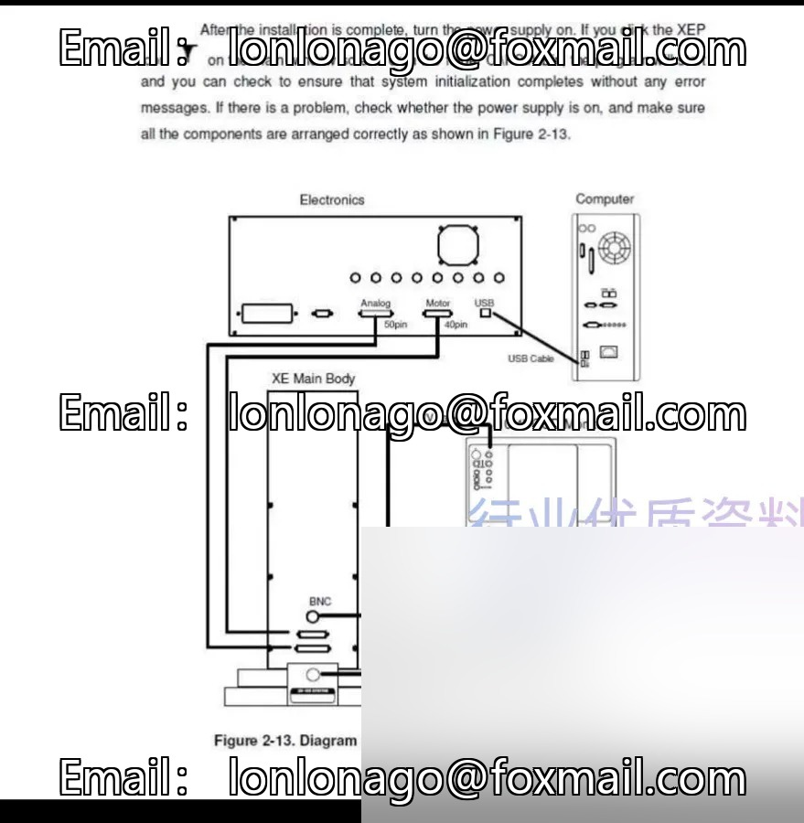
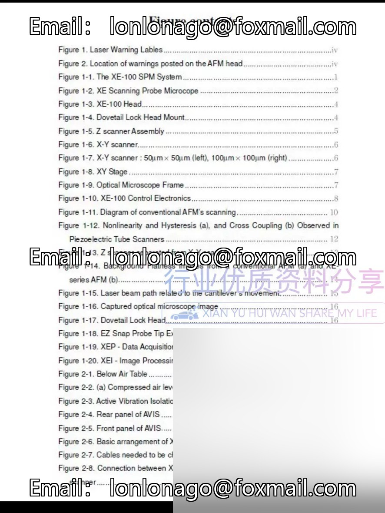
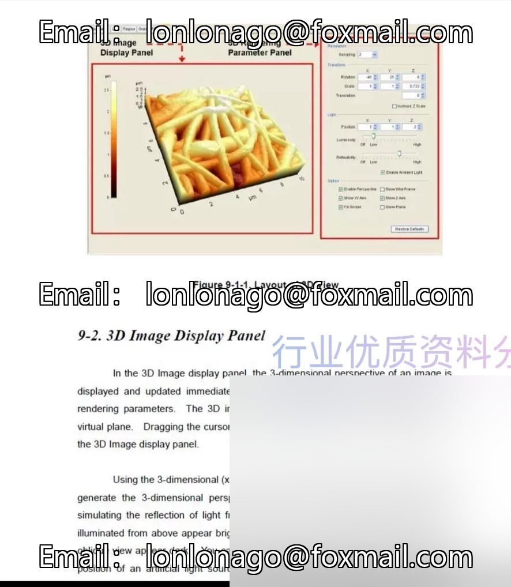

# Korean Park XE-100, XE-150 atomic force microscopy user

## Body

Manual for the Korean Park XE-100, XE-150 atomic force microscope and XEI analysis software, with 500 pages of comprehensive content including detailed structure descriptions, operation and maintenance methods, etc., which have significant reference value.

Capture and send the electronic original directly! The following images include screenshots of the file portion. Please confirm before placing the order! Due to the replicable nature of electronic documentation Therefore, are allowed after purchase! Thanks for understanding!

For personal learning and reference only!

The materials include the user manuals and analysis software instructions for the Korean Park XE-100 and XE-150 atomic force microscope, covering structural descriptions and operation and maintenance methods across 500 pages.

<!-- AI_ENRICHED -->

## Images

## Payment

Here is a pay link on Stripe ( https://buy.stripe.com/3cs8yP7sY87d0vu9AB ). Please contact me lonlonago@foxmail.com after funding $89, and I will send you a complete data files , thank you!

